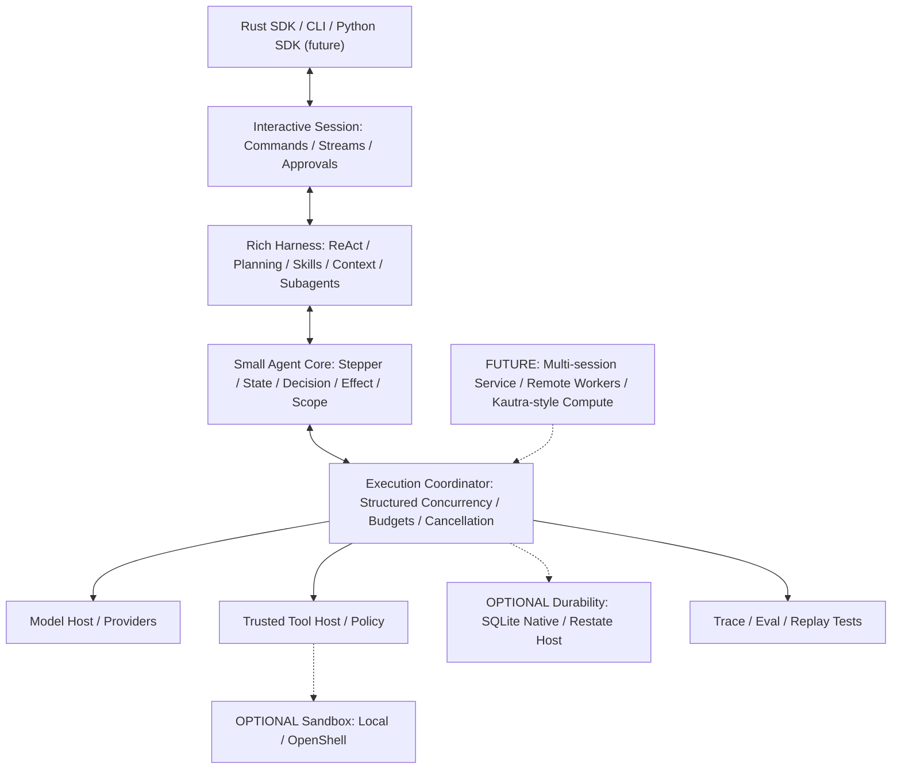
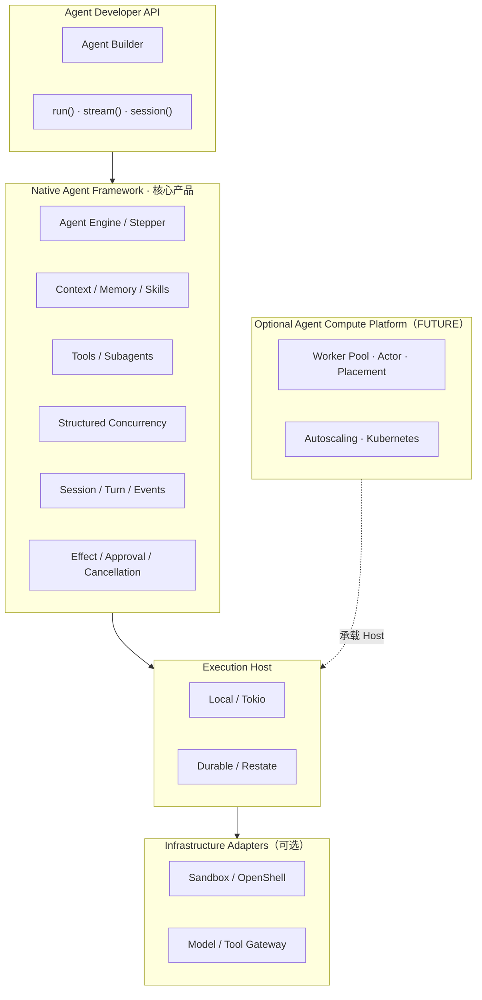

# Autra（Agent-Native Framework）：完整项目设计与开发规范

> **文档版本**：v1.0 — Architecture Proposal / Draft  
> **项目名称**：Autra  
> **增补**：§4.4 产品分层视图；§4.5 领域归属与代码位置；项目定名 Autra（2026-11-20）  
> **日期**：2026-11-19  
> **项目类别**：Rust 原生 Agent Framework（非 Agent Hosting Platform）  
> **核心定位**：Composable Intelligence · Structured Execution · Explicit Effects · Optional Infrastructure  
> **成熟度**：**设计提案**，本文中的代码、CLI、API、指标与版本均为拟议内容，不代表已经实现或发布。

---

## 0. 阅读指南与执行摘要

### 0.1 一句话定义

Autra 是一套 **Rust 原生、可组合、可交互、可测试的 Agent Framework**：内置完整且易用的 Agent Harness，同时提供清晰的执行语义、受控工具副作用、结构化并发、可选持久化与可信执行环境。开发者可以在一个本地进程中运行 Agent；只有出现实际需求时，才启用 Restate、OpenShell、远程 Worker 等基础设施。

我们**不是**通用 Agent 托管器，不以托管 LangGraph、Claude Code 或 Kagent 为第一目标；不把 Kubernetes、Actor 资源调度或独立数据库服务器作为使用前提；也不企图重新实现 Restate 的通用 Durable Workflow、OpenShell 的操作系统隔离或 Tokio 的任务调度。

**最终产品体验**：

```rust
// 拟议公开 API，展示开发者体验，而非当前可编译接口
let agent = Agent::builder("repo-assistant")
    .model(model)
    .instructions("Help users understand and improve Rust projects.")
    .tool(ReadFile)
    .tool(RunTests)
    .context(RepoContext::new("."))
    .build()?;

// 默认本地运行：不需要数据库、K8s 或 Agent Server
let answer = agent.run("检查项目中的失败测试").await?;
```

当需要持久化审批、受限 Sandbox 或结构化子任务时，使用**同一套 Agent 定义**启用相应能力：

```rust
// 拟议组合方式，尚未冻结 API
let runtime = Runtime::builder()
    .with_durability(SqliteDurability::open("runs.db")?)
    .with_sandbox(OpenShellBackend::new(config))
    .with_limits(ExecutionLimits::new().max_child_runs(4))
    .build()?;

let run = runtime.start(agent, task).await?;
```

上述两种调用不能暗示保证完全相同。无持久化的本地执行可以支持会话与取消，但**不能**承诺跨进程故障恢复；选择 Restate Host 时，也不能假设它与 Native Host 具有完全相同的 API、日志及恢复边界。

### 0.2 什么叫“整体改进”

我们的目标不是逐项超越成熟项目，而是把它们已经验证的优点，组织成一套**不互相打架**的系统：

- **Rig**：小而类型安全的、可逐步驱动的执行模型；
- **DSH/Cordis**：可组合的服务/插件、依赖与生命周期；
- **Codex**：真实 Coding Agent 的交互式 Session、Turn、上下文、安全与工具体验；
- **LangGraph**：显式状态、并行结果合并、Interrupt 与持久化边界；
- **Deep Agents**：Planning、Skills、文件系统、Subagents 与 Context 的开箱即用体验；
- **Restate**：持久化步骤、Journal、Replay、可靠等待与重试；
- **OpenShell**：可信 Sandbox 与策略强制实施；
- **Kagent / Agent Substrate**：逻辑会话不与物理计算资源一一绑定，以及资源容量应受控。

它们的概念不是一个层次，也不是全都要在第一版自研。我们追求的是**语义层统一、实现层模块化、基础使用零基础设施前置依赖**。

### 0.3 本文的约束性标记

| 标记 | 含义 |
|---|---|
| **CORE** | 框架的核心语义，原则上不随基础设施变化 |
| **DEFAULT** | 推荐的开发体验/缺省行为，可以由用户显式覆盖 |
| **OPTIONAL** | 额外能力或部署后端，首版不是依赖 |
| **FUTURE** | 已预留边界，但不承诺当前实现 |
| **INVARIANT** | 代码与测试应确保的系统不变量 |
| **PROPOSAL** | 尚未冻结的 API、Schema 或设计方案 |

### 0.4 阶段性完成标准

第一可用版本：一个真实 Rust Agent 能完成单 Agent ReAct、结构化 Tool Calling、流式输出、工具审批和有限并发工具调用，并在本地进程正确取消与回收任务。

第一可靠版本：能够在**已明确持久化的边界**暂停、审批、继续执行，对外部 Tool 的结果未知状态采取安全、可测试的策略。

第一完整 Harness 版本：具备 Context 管理、Skills、Planning、受限 Subagents、Workspace Tools、Tracing 与基础 Evaluation。

---

## 1. 产品定位、目标用户与非目标

### 1.1 产品定位

**Agent Framework first; infrastructure when needed.** 框架提供 Agent 行为开发与执行的公共语义；Runtime 为该语义提供本地、持久化或远程承载方式；基础设施不是框架核心的先决条件。

这与过去的 Agent-Native Computing Platform 方向不同。本版本**收缩主产品边界**，保留未来扩展能力，而不以通用分布式平台为默认产品形态。

### 1.2 目标用户

| 用户 | 常见需求 | 我们提供的首要价值 |
|---|---|---|
| Rust Agent 开发者 | 用少量代码写 Tool Calling、ReAct、Context | 类型化 SDK、容易理解的执行与错误语义 |
| Coding / Research Agent 开发者 | 规划、文件工具、Skills、Subagents、审批 | 完整 Harness 能力，而非只有 Provider Wrapper |
| 可靠性工程师 | 故障、中断、取消、工具副作用、可复现测试 | 显式 Execution Contract、可选 Durable Host |
| Agent 服务开发者 | 同时处理多个 Run、控制成本和并发 | 有界异步执行、Session 隔离、任务预算 |
| 平台工程师（后续） | 执行资源、治理、容器隔离、评测 | 可选服务适配与执行后端，不反向污染 Core |

### 1.3 明确不做（特别重要）

- **不是**“LangGraph / Claude Code 托管平台”，短期不开发兼容运行驱动。
- **不是**从零重写 Tokio、Temporal/Restate、Docker、Kubernetes、OpenShell。
- **不是**以通用 Graph DSL 作为唯一 Agent 执行表示。
- **不是**每次 Agent 运行都要启动一个独立 Actor、Pod 或 Sandbox。
- **不是**强制用户使用 SQLite、Redis 或 PostgreSQL 才能运行 Agent。
- **不是**宣称任意外部 Tool 具备 Exactly-once 副作用。
- **不是**将所有 Extension 放在同一个具有全部凭证的受信任进程中还宣称“沙箱安全”。
- **不是**第一版就做 Web Studio、MarketPlace、多租户控制面或 GPU 调度。

### 1.4 设计成败的可证伪条件

如果相同任务中，比直接使用 Rig 多写大量样板代码、没有提升控制/调试能力，说明高层 API 不够简洁；如果并发工具造成不可解释的状态竞态，说明结构化并发设计失败；如果从持久化模式恢复导致不可见的重复外部操作，说明执行契约不足；如果为了启用一个普通 Agent 必须部署整套平台，说明产品边界已经偏离。

---

## 2. 参考系统、借鉴范围与主动取舍

| 项目 | 我们继承的思想 | 我们不会直接复制的设计 | 对应本项目模块 |
|---|---|---|---|
| Rig | Rust Builder、Sans-I/O Stepper、结构化 Tool/Provider | 不把可序列化状态等同于事务级 Durable Execution | `autra-core`, `autra-models` |
| DSH / Cordis | 可替换行为能力、服务依赖、生命周期 | 不把 Journal 提交/安全策略当可任意 Hook | `autra-harness`, 扩展注册机制 |
| Codex | Session/Turn、消息协议、审批、执行协调、Context | 不以 Coding Agent 单一产品形态限制所有使用场景 | `autra-session`, `autra-tools` |
| LangGraph | 显式状态、并发结果合并、Interrupt | 不强制 Graph Everywhere | `autra-runtime`, `autra-concurrency` |
| Deep Agents | 开箱即用 Planning、Skills、子 Agent、文件系统 | 不把高级功能写死进最小 Core | `autra-harness`, `autra-context` |
| Restate | Journal、Durable Steps、可靠等待和重试 | 不把 Restate 当存储 Backend，也不双重拥有 Journal | OPTIONAL `autra-restate` |
| OpenShell | 可信 Supervisor 与策略强制执行 | 不把工具声明当作 OS 级隔离 | OPTIONAL `autra-openshell` |
| Kagent / Substrate | 多 Session、逻辑工作与计算资源分离、容量复用 | 不在 Framework Core 内建分布式 Actor Placement | FUTURE `autra-compute` |
| Polos | 一体化 Agent 工程体验、可观测的任务运行 | 不把完整编排平台作为最小安装要求 | 端到端体验对照 |

对照源应在实际实现时固定版本/Commit，并记录源码路径与行为测试。项目名称、API 和官方架构可能变化；第 29 节记录阅读入口。

---

## 3. 设计哲学与工程原则

### 3.1 总纲

> **Composable Intelligence. Structured Execution. Explicit Effects. Optional Infrastructure.**  
> 可组合智能、结构化执行、显式副作用、可选基础设施。

另一句约束架构边界的原则是：

> **Unified at the semantic level, modular at the implementation level.**  
> 语义层统一，实现层模块化。

在这两个总纲之下，五个可检验的架构目标是：

| 目标 | 含义 | 当前证据与约束 |
|---|---|---|
| 语义统一 | ReAct、Planning、Workflow、Subagent 共享同一套 Run、Scope、Event 与 Effect 执行协议 | 一个 `AgentStepper`/`Transition` 协议（拟议改名为 `TransitionProposal`）、一个 runtime coordinator；Workflow 尚未实现 |
| 能力可组合 | Context、Memory、Skills、Tools、Sandbox、Durability 独立组合，不改变彼此的基本语义 | ContextBuilder、SkillRegistry、ToolRegistry、Provider seam；Memory/Sandbox 仍为可选后续 |
| 执行可验证 | 取消、并发、审批、副作用、恢复都有明确契约与测试 | INV-01..10、Agent/Stepper/Tool seam、确定性测试；durable fault matrix 待做 |
| 基础设施可选 | 默认 Tokio 本地运行；恢复、隔离、分布式执行按需启用 | `LocalEphemeral` 默认；SQLite/Restate/OpenShell 可选（ADR-0003/0008/0009） |
| 简单入口、强大内核 | 普通开发者不必理解 Stepper/Journal/Effect Ledger；高级能力显式开启 | `Agent::builder(...).run()`；`RunOptions`、Approver、Session、Context 为显式高级入口 |

### 3.2 九条设计原则

| 原则 | 具体设计约束 | 可验证方式 |
|---|---|---|
| P1. Small Core, Rich Harness | 核心只定义 State/Decision/Effect/执行身份；Planning/Skills/MCP 放在上层 | 不改 Core 就能替换 Context/Planner |
| P2. Behavior Composable, Semantics Protected | Engine、Model、Tools 能扩展；状态提交/权限不能随意绕过 | 恶意/错误扩展不能改变合法状态转换 |
| P3. Structured Agent Concurrency | Child Run 和并行 Tool 都有父作用域、预算、取消与 Join | 取消父 Run 后不会留下无主任务 |
| P4. Explicit Effects | 模型与外部工具是可追踪 I/O 边界 | 每个执行意图能关联结果或未知状态 |
| P5. Context Is a Versioned View | Context 是模型输入视图，不是权威 Journal | 压缩 Context 不改变已完成步骤 |
| P6. Durability Is Conditional | 只有显式 Host/持久化边界才承诺恢复 | 故障注入验证每个承诺 |
| P7. Authority Is External to the Agent | Tool/Skill 不自行授予 OS/网络/凭证权限 | 越权请求由可信 Host 拒绝 |
| P8. Logical Work Outlives Process | Session/Run 与具体 Tokio Task/Worker 分离 | 等待审批期间可恢复到适当 Host |
| P9. Evidence Over Claims | Trace、Contract Tests、Evaluation 伴随功能 | 公开测试与基准脚本可复现 |

### 3.3 不变量（实现中不得破坏）

- **INV-01：同一 Run 的权威状态提交有明确定序。** 并发 Effect 可同时执行，但结果接受和状态合并必须受控。
- **INV-02：可持久化模式中，决策状态与待分发 Effect Intent 必须原子提交。** 实现手段可为事务性 Outbox 或执行宿主提供的同等保证。
- **INV-03：Tool 成功后结果丢失属于 `OutcomeUnknown` 候选，不可自动推定“未执行”。**
- **INV-04：Command、Durable Event、Stream Event、Telemetry 是不同类型，不得用 Trace 恢复业务状态。**
- **INV-05：子任务只能获得明确授予的权限和预算。** 不能默认无限扩展父 Agent 权限。
- **INV-06：取消不等于撤销外部副作用。**
- **INV-07：Context Compaction 不得删除或改写权威执行事实。**
- **INV-08：不存在隐含的跨 Host 等价性。** Local / SQLite Durable / Restate 明确声明支持的保证。
- **INV-09：一份权威 Journal 只允许一个执行宿主控制；Workspace 存储和 Journal 是不同真相来源。**
- **INV-10：不可信代码不能在拥有控制面凭证的同一权限域中运行还声称隔离。**

---

## 4. 总体架构与依赖规则

### 4.1 逻辑架构



**解释**：图中双向箭头表示逻辑协作而非直接循环依赖。Agent Stepper 的状态转换本身应当保持 Sans-I/O；具体 Effect 由 Host 执行。底层不应反向依赖上层 Harness。本节是运行期视图；产品分层、安装边界与各层保证归属见 §4.4。

### 4.2 一项最重要的重构：框架 vs 基础设施

| 层 | 核心能力 | 是否必须安装 | 第一版部署形态 |
|---|---|---|---|
| Agent Core | State/Decision/Effect/Scope/Stepper | 是 | Rust 库 |
| Rich Harness | ReAct/Tools/Context/Skills/Planning/Subagent | 基础 Harness 是 | Rust 库 |
| Local Execution | Tokio、有界并发、取消、超时 | 是 | 同进程 |
| Interactive Session | Turn、Streaming、审批与输入 | 是 | 同进程 |
| Persistence | Journal、Checkpoint、恢复 | 否 | SQLite 插件/模块 |
| Trusted Sandbox | 强制进程/文件/网络隔离 | 否 | OpenShell 等独立后端 |
| Restate Host | 远程 Durable Invocation/Journal | 否 | 单独服务 + Rust SDK |
| Elastic Compute | Actor/WorkerPool/K8s | 否，后续按需 | 独立服务/项目 |
| Control Plane | Artifact/Revision/Policy Registry | 否，后续按需 | 独立服务 |

### 4.3 代码依赖方向

```text
autra-core                    (无 Tokio / DB / OpenShell / Restate 依赖)
    ↑
autra-harness / autra-context / autra-tools / autra-session
    ↑
autra-runtime           (Tokio)
    ↑
autra-cli / examples

可选扩展依赖核心协议，而不是核心依赖扩展：
autra-durable-sqlite · autra-restate · autra-openshell · autra-otel
```

避免：在 `autra-core` 中出现 `OpenShellClient`、SQLx Pool、Restate Context、Kubernetes Pod 或 HTTP 路由类型。此项可用依赖检查和构建 Feature 测试验证。

### 4.4 产品分层视图：从开发者 API 到可选计算平台

> 本节与 §4.1 是两个正交视图：§4.1 描述一次 Run 内部的**控制与数据流**，本节描述产品的**安装边界与保证归属**。两者共享同一组领域对象（Session / Turn / Run / Effect），但不能互相替代。



**图中各层的归属与承诺：**

| 层 | 图中的内容 | 归属 | 该层拥有的承诺 | 对应章节 / 代码 | 里程碑 |
|---|---|---|---|---|---|
| Agent Developer API | Agent Builder、`run()`、`stream()`、`session()` | 本项目（门面） | 只提供人机工程；不新增执行语义，不得绕过 Effect/Approval | §14.1；`autra-cli` / 未来 SDK | M1 |
| Native Agent Framework（核心产品） | Engine/Stepper、Context/Memory/Skills、Tools/Subagents、Structured Concurrency、Session/Turn/Events、Effect/Approval/Cancellation | 本项目 | 状态转换、结构化并发、取消、审批与 Context 视图的语义（CORE） | §6–§11；`autra-core`、`autra-harness`、`autra-runtime` | M1–M3 |
| Execution Host | Local / Tokio；Durable / Restate | Local 是默认；Durable / Restate 可选 | 权威 Journal、Effect 接受与恢复边界；因 Host 而异 | §12；`autra-runtime`、`autra-durable-sqlite`、`autra-restate` | M1 / M4 / M7 |
| Infrastructure Adapters | Sandbox / OpenShell；Model / Tool Gateway | 可选 | 隔离、凭证、网络与限流等外围能力；不拥有执行状态 | §13、§9；`autra-openshell`、`autra-mcp` / Gateway | M6（MCP V0.5） |
| Optional Agent Compute Platform | Worker Pool、Actor、Placement、Autoscaling、Kubernetes | FUTURE，独立项目 | 容量、放置与扩缩容；不改变 Core 语义 | §10.6；`autra-compute` | M8 |

图中未展开的两项横切能力：**Trace / Eval**（§17，横切所有层，且不得成为权威状态来源）与 **Workspace**（§9.4，是 Tool 执行的环境引用，由 Host 与 Adapter 共同约束）。"Model / Tool Gateway" 是本视图引入的**可选** Adapter 名称：默认本地模式下 Harness 直接调用 Provider、Runtime 直接派发 Tool；Gateway 只在需要集中凭证、出口策略、限流或远程工具分发时出现。

**与当前架构的关系：**

1. **运行期视图 vs 安装视图。** §4.1 回答"一次 Run 里谁产生意图、谁执行、谁提交"；本图回答"用户装了什么、每一层各自承诺什么"。任何一层新增的能力，都必须能在 §4.1 的执行闭环中找到落点（Command、Durable Event 或 Effect），否则它只是外围工具，不应进入核心产品。

2. **"核心产品"盒 = §4.2 的前四行。** Small Core、Rich Harness、Local Execution、Interactive Session 合起来，才是"装一个 crate 就能跑 Agent"的范围。图中把它标为"核心产品"，与 §1.3 的"不是平台"一致：下面的 Host / Adapter / Compute 都不是运行前提。

3. **六个能力块不是六个 crate。** 它们是逻辑能力，初期物理上落在 4 个 crate（§19.1），随真实修改频率再拆（§19.2）。不要按图的横向切分创建一组空 crate。

4. **Execution Host 是权威边界，不是"运行位置"。** Local/Tokio 只拥有进程内状态，不承诺崩溃恢复；Durable/Restate 才承诺在已记录边界恢复。图中的 "Durable / Restate" 应读作两个独立 Host（`NativeDurable` 与 `RestateHosted`），不是一个 Host 的两种模式：它们共享 Stepper 语义，但恢复、计时与投递保证不同（INV-08、§12.1）。切换 Host 不改变 Agent 定义，但改变对外承诺。

5. **Adapter 不获得决策权。** Model/Tool Gateway 可以集中模型凭证、出口策略、限流、审计与远程工具分发，但 Effect 的授权、审批绑定与结果接受仍由可信 Host 完成（P7、§18.3）。Sandbox 只实施隔离与环境生命周期，不恢复执行逻辑（§13.3）。把 Gateway 当成"中央执行器"会同时违反 INV-02 与 INV-09。

6. **Compute Platform 只能向下承载，不能向上渗透。** 它消费与本地 Host 相同的执行协议，负责放置、租约与扩缩容；不得把 Actor/Worker 身份引入 Session/Run 的语义（ADR-005）。它是否存在，不改变 §30 验收问题在 Core 层的表述。

7. **层序是依赖顺序，不是交付顺序。** M1 同时交付 API、Framework 与 Local Host；M2 补结构化并发与 ChildRun；M3 补完整交互与审批；M4 补 Durable；M6 补 Sandbox/Telemetry；M7 补 Restate；M8 才是 MCP、Python SDK、API 服务与 Compute（§22.1）。

8. **一个检查问题。** 如果某个功能只能在本图的上层描述，却在 §4.1 的执行闭环里找不到对应的 Command、Durable Event 或 Effect，那么它不应进入核心产品——最多作为 Adapter 或工具存在。


---

### 4.5 领域归属与代码位置

"属于 Core"表示框架必须保证的语义，不表示必须放进 `autra-core` crate。

| 概念 | 领域归属 | 当前代码位置 |
|---|---|---|
| Session / Turn | Session 层 | `autra-runtime` |
| Run | Core + Runtime | `autra-core` 状态；`autra-runtime` 执行 |
| ChildRun | Core + Runtime | tool-backed subagent；runtime ChildRun 待做 |
| Effect | Core + Host | Core 定义 intent 与 outcome；runtime 派发 |
| Context | Harness | `autra-harness` ContextBuilder |
| Workspace | Core 引用 + Adapter | `LocalWorkspace` 在 harness；Sandbox 待做 |

`AgentState` 是 RunState 的当前 Rust 类型，携带可选的 `session_id` 与
`turn_id`。直接 `Agent::run` 没有 Session/Turn；`Session::run_turn` 为每轮
生成新的 TurnId 并传入 Run。Session 的完整模型、历史与运行管理暂放在
`autra-runtime`；出现第二种 Session 实现或持久化需求时再评估拆出
`autra-session`。

---

## 5. 领域模型：明确概念的边界

### 5.1 对象定义

| 对象 | 定义 | 是否属于 Core | 生命周期 |
|---|---|---|---|
| `AgentDefinition` | Agent 行为及需要的能力组合 | 是 | 创建/修改定义 |
| `AgentRevision` | 已冻结配置及协议/工具版本快照 | 逻辑模型是；Registry 否 | 发布到废弃 |
| `Session` | 与用户/调用方持续交互的语义容器 | 是 | 创建到关闭 |
| `Turn` | 一次输入到响应/等待的交互边界 | 是 | 单轮交互 |
| `Run` | 完成一个任务目标的逻辑执行 | 是 | 启动到完成/取消 |
| `ChildRun` | 父 Run 创建、受父作用域约束的子任务 | 是 | 创建到汇合/取消 |
| `Effect` | 一次可观察的 I/O 意图及其结果 | 是 | 请求到完成/未知 |
| `ExecutionScope` | 权限、预算、可取消性、Trace 和父任务身份 | 是 | 随 Run/ChildRun |
| `ContextSnapshot` | 某次模型输入的受控视图 | 是（元数据） | 单次模型请求 |
| `WorkspaceRef` | 文件环境的标识与版本引用 | 是（引用） | 环境存活期 |
| `RunAttempt` | 单次物理执行尝试 | OPTIONAL Runtime | 每次执行调度 |
| `Actor` / `Worker` | 计算执行实体及承载资源 | FUTURE Compute | 按容量调度 |

**关键区分**：`Session != Run != Task != Worker`。Session 是会话，Run 是逻辑任务，Tokio Task/Worker 是一次执行方式。我们允许 Session 内多个 Turn，但默认对同一会话状态采用单写者推进策略。

**领域归属与代码位置**：上表“属于 Core”表示框架保证的语义，不表示必须放在 `autra-core` crate。`SessionId`、`TurnId` 与 RunState 上的可选引用属于 Core；Session 的完整模型、历史与运行管理由 runtime 的 Session 层负责，Context 构建由 Harness 负责。详见 §4.5 与 ADR-0022。

### 5.2 父子结构示例

```text
AgentDefinition: repo-assistant
   └─ AgentRevision: rev-001
        ├─ Session: s1
        │   ├─ Turn t1 ── Run r1 ── Completed
        │   └─ Turn t2 ── Run r2 ── WaitingApproval
        │                       ├─ ChildRun r2a (search)
        │                       └─ ChildRun r2b (tests)
        └─ Session: s2
            └─ Turn t3 ── Run r3 ── Running
```

### 5.3 身份、版本和归属

所有核心记录使用不可复用的 `session_id`、`turn_id`、`run_id`、`effect_id`；Child Run 有 `parent_run_id`；Context 构造记录使用 `context_id`、`builder_revision`、`source_refs`；若涉及 Workspace 修改，还关联 `workspace_id` 与可验证版本。不要把“相同字符串的任务描述”误认为相同执行。

---
## 6. Agent Core：Sans-I/O Stepper 与决策协议

### 6.1 Core 的任务

Core 只回答：**基于当前已接受的事件与状态，Agent 应产生什么下一步执行意图？** 它不直接访问网络、Shell、数据库，也不依赖具体模型 SDK。这里的“纯”指核心状态转换可确定地处理输入，**不**代表模型推理本身是确定性的。

```rust
// PROPOSAL：仅为核心设计草图；实际 API 会在首个原型后冻结。
#[derive(Clone, Debug, Serialize, Deserialize)]
pub struct AgentState {
    pub run_id: RunId,
    pub phase: AgentPhase,
    pub history: Vec<AcceptedRecord>,
    pub budget: BudgetSnapshot,
}

pub trait AgentStepper: Send + Sync {
    fn transition(
        &self,
        state: &AgentState,
        event: &AcceptedEvent,
    ) -> Result<Transition, StepError>;
}

pub struct Transition {
    pub next: AgentState,
    pub intents: Vec<EffectIntent>,
    pub disposition: RunDisposition,
}

pub enum EffectIntent {
    CallModel(ModelCallSpec),
    CallTool(ToolCallSpec),
    RequestApproval(ApprovalSpec),
    SpawnChild(ChildRunSpec),
    WaitForSignal(WaitSpec),
}
```

`AcceptedEvent` 是已经由 Coordinator 接受、具有明确定序的事件；并不代表任何网络来的消息都能直接输入 Stepper。实际实现必须考虑 AgentState 大量历史带来的拷贝成本，可采用状态引用、结构共享或增量存储，而不影响语义。

### 6.2 完整执行闭环

```text
AcceptedEvent ───▶ AgentStepper ───▶ Transition
                                      │
                         ┌────────────┴───────────┐
                         ▼                        ▼
                     Next State              Effect Intents
                         │                        │
                         └────── Coordinator ─────┘
                           (提交或接受转换)
                                      │
                            Effect Host 执行
                                      │
                            Effect Result / Error
                                      │
                            AcceptedEvent ...
```

在 **Local Ephemeral Host** 中，Coordinator 可以使用内存记录执行进度；在 **Native Durable Host** 中，状态变更、Durable Event 与 Effect Intent 需在原子边界提交；在 Restate Host 中，使用 Restate 已提供的 SDK/Journal 语义而非模仿 SQLite Outbox。

### 6.3 分离四种消息

| 分类 | 例子 | 谁产生/决定 | 是否为权威恢复依据 |
|---|---|---|---|
| **Command** | `SubmitTurn`、`CancelRun`、`ApproveEffect` | 用户/外部系统请求，经验证后被接受 | 仅其“已接受事实”可参与恢复 |
| **Durable Event** | `EffectIntentRecorded`、`ToolResultCommitted`、`RunSuspended` | Execution Host | 是，在启用持久化时 |
| **Stream Event** | Token Delta、工具 stdout、进度片段 | Model/Tool/Session | 否，允许丢失或重复；可重新同步 |
| **Telemetry** | OTel Span、统计计数、评测标签 | Observability | 否，不能替代执行状态 |

Stream Event 可附带 `run_id`、`seq_hint`、`effect_id` 和递增流偏移；跨连接的严格无重不丢需要额外持久化机制，不是 WebSocket/SSE 自带的保证。

### 6.4 Agent Engine 与 Harness 的边界

`AgentStepper` 决定动态执行；`ReActEngine` 是其第一种实现；`Planning`、`SkillLoader`、`MemoryRetriever`、`SubagentPolicy` 可以形成 Harness 能力组合。不要预先为所有可能的 Planner/Workflow 设计一个万能抽象。遇到第二个真正不同的 Engine 时再抽取公共接口。

### 6.5 单次 Model 调用示例

```text
RunStarted
   → ContextBuildRequested
   → ContextBuilt(view_id, model_request_digest)
   → ModelCallRequested(effect_id)
   → [ModelStreamDelta ...]  (非权威)
   → ModelResultCommitted(message, tool_calls, usage)
   → AgentStepper decides ToolCall / FinalAnswer
```

模型调用可能是有成本的非确定性 I/O。已持久化的 Model Result 应在恢复时重放；流式 Token 只是交互体验，不保证可用来重建完整模型响应。模型提供商支持的缓存、断点或幂等特性需独立声明。

---

## 7. Rich Harness：可组合智能行为

### 7.1 第一层“直接可用”能力

框架内置一个开箱即用的 `Agent`/`ReAct` 高级 API，默认提供：基础对话历史、结构化 Tool Calling、消息 Streaming、工具错误回传、最大轮次、Token/成本预算、基本 Context 构造、取消和超时。普通 Agent 不需要手写 Stepper、Effect Record 或 Journal。

### 7.2 第二层“按需组合”能力

| 能力 | 责任 | 不应影响的东西 | 迭代顺序 |
|---|---|---|---|
| `Planning` | 任务分解、Todo、计划修订 | 核心状态提交所有权 | V0.4 |
| `Skills` | 按需加载可复用指令/能力描述 | 不自动授予 Tool 权限 | V0.4 |
| `Subagents` | 创建受限 ChildRun | 不产生无主任务或无限权限 | V0.3–0.4 |
| `ContextCompaction` | 历史压缩、Token 管理 | 不删除执行事实 | V0.4 |
| `Memory` | 跨 Session 信息读写 | 不代替执行 Checkpoint | V0.5 |
| `MCP` | Tool 发现和调用协议 | 不跳过本地权限/结果分类 | V0.5 |
| `Workflow` | 明确依赖和执行顺序的流程 | 不将所有 ReAct 逻辑强转为 Graph | FUTURE |

### 7.3 扩展接口的安全级别

区分 **Trusted Library Extension** 与 **Untrusted Tool Workload**。同一 Rust 进程内的第三方插件/动态库原则上与宿主共享进程权限，Trait、Hook、Capability 数据字段本身不能提供 OS 隔离。要处理不可信代码时，应将 Tool 或代理执行环境放在 Sandbox/独立权限域中。

Hooks 默认分为：

- **Observer**：读取运行事件、记录指标，不得修改已接受事实。
- **Behavior Modifier**：在 Agent 决策前调整 Context、可见工具或 Planner 策略；变更应该版本化、可追踪。
- **Policy Authority**：由受信任的 Host 安装，不通过普通扩展注册提升权限。

考虑 DSH 的服务依赖生命周期，但第一版只要求显式构建时依赖校验和稳定的关闭顺序；不开发动态热加载和复杂全局 Service Locator。

---

## 8. Context Engineering 与 Memory

### 8.1 三层状态严格分离

| 名称 | 回答什么 | 主要内容 | 可否压缩/重建 |
|---|---|---|---|
| **Execution State / Journal** | 程序做过什么、能否继续 | Run 状态、已确认 Effect、审批 | 不可随意改写；按协议迁移 |
| **Context View** | 下一次模型看什么 | 系统指令、历史选择、文件片段、Skill、工具 Schema | 可以，须保留来源与版本 |
| **Long-term Memory** | 跨任务保留什么 | 用户偏好、知识条目、检索索引 | 可以，按权限与保留策略管理 |

### 8.2 Context 构建流水线

```text
Agent Revision / Instructions
         + Session History
         + Accepted Tool Observations
         + Workspace Reads
         + Skills / Retrieved Memory
         + Budget / Policy
                   ↓
             ContextBuilder
          ┌────────┼────────┐
       Selection  Compaction  Provenance
          └────────┼────────┘
                   ↓
             ModelRequest
            (Versioned View)
```

### 8.3 `ContextRecord` 必需字段（提案）

`run_id`、`turn_id`、`model_effect_id`、`builder_revision`、`agent_revision`、`model_configuration`、`source_refs[]`、`visible_tools_hash`、`request_digest`、`request_snapshot_ref?`、`token_budget`。完整请求与工具结果可能包含敏感信息，默认记录应支持脱敏、加密和保留期限；仅凭哈希无法精确复现请求。

### 8.4 Context Compaction 规则

- 压缩不能消除未处理的审批、未完成的 ToolCall ID 或已确认的执行事实。
- 摘要是模型输入材料，不是不可变事实来源；对重要结论保留可追溯原始来源。
- 压缩策略需要版本号，才能比较不同策略的 Token、质量和成本。
- Context 可能包含不可信文件和网页内容，应在 Prompt 语义层标注数据来源，**并**由 Tool Host 独立实施权限边界。

---

## 9. Tool System、权限与外部副作用

### 9.1 Tool 的两部分

**Tool Description** 面向模型：名称、自然语言描述、输入/输出 Schema、调用约束。**Tool Execution Contract** 面向 Runtime：谁被允许使用它、在哪里执行、资源/超时、是否可能写入外部状态、如何处理结果未知。两者不能混为一份自然语言描述。

```rust
// PROPOSAL：最小语义示例，不是冻结的生产 API
pub struct ToolContract {
    pub name: ToolName,
    pub schema_revision: String,
    pub effect_class: EffectClass,
    pub required_scopes: Vec<CapabilityScope>,
    pub concurrency_policy: ToolConcurrencyPolicy,
    pub timeout: Duration,
    pub retry_policy: RetryPolicy,
}

pub enum EffectClass {
    ReadOnly,
    Idempotent { key_supported: bool },
    Reconcileable,
    NonIdempotent,
    Unknown,
}
```

`EffectClass` 是执行与审查的提示，不是自动可信的外部保证。对于安全重要的工具，必须通过受信任的 Adapter 或实际服务契约验证该能力。某个文件写入是否原子，需要 Workspace/FS 提供真正的版本检查或原子提交，不能只靠用户态的读后比对。

### 9.2 Tool 调用生命周期

```text
ToolIntent Proposed
    → Scope/Budget Validation
    → Approval? (optional durable wait)
    → Authorized Intent
    → Dispatch Attempt
    → Executed / Failed / Rejected / OutcomeUnknown
    → Accepted Tool Result / Reconciliation Needed
```

**重要**：ToolCall 被模型建议，并不意味着已经获得系统授权。审批是对**具体 Tool、具体参数摘要、具体身份和策略版本**的授权；参数变化意味着必须重新批准。

### 9.3 Retry 与恢复规则

| Tool 类别 | 例子 | 重试原则 |
|---|---|---|
| ReadOnly | `read_file`、查询状态 | 通常可重试；要考虑外部数据变化 |
| Stable Idempotent | 接受幂等键的更新 API | 使用同一 Effect ID/Key 重试，并验证服务保证 |
| Reconcileable | Git 提交、条件文件写入 | 先查询实际状态，再选择继续/补偿/重试 |
| NonIdempotent | 付款、发邮件、不可查询的外部动作 | 不自动盲目重试，必要时人工介入 |
| Unknown | 未分类第三方工具 | 默认保守：需要明确审批/禁用自动重试 |

### 9.4 Workspace 合约

Workspace 至少需要表达：`workspace_id`、Backend、有效期、权限 Scope、可读写范围、可选的版本/快照引用。*持久化执行状态* 不等于 *Workspace 持久化*。若 Tool 产生文件副作用，能否恢复应由 Workspace 实际存储语义决定。

### 9.5 第一批 Coding Tool

`read_file`（默认只读），`list_files`（只读），`apply_patch`（版本/内容前提），`run_tests`（受限命令、超时、输出限制），`git_status`（只读），`git_commit`（审批与仓库状态校验），`git_push`（高风险、显式审批、谨慎对待远端副作用）。

**Local Development Mode** 可以提供便利的“在用户当前目录运行”模式，但必须清楚告知它没有获得强 Sandbox 隔离；未经显式允许，不应将任意模型生成命令当成宿主特权命令执行。

---

## 10. 结构化并发：框架核心能力，但不是分布式调度平台

### 10.1 四种并发及其边界

| 并发层级 | 我们应该支持什么 | 属于 Framework Core 吗 |
|---|---|---|
| **同一次 Run 的并行 Tool** | Fan-out、Join、并发上限、冲突控制 | **是** |
| **Subagent / ChildRun 并发** | 作用域继承、预算、取消与结果合并 | **是** |
| **本地多 Session 并发** | 多 Run 隔离、有界任务执行、背压 | 基础能力是 |
| **Actor / WorkerPool / K8s** | 多机放置、弹性容量、租约和扩容 | **否，FUTURE 可选基础设施** |

### 10.2 结构化并发的必须语义

- Parent Run 创建 ChildRun 时，指定 `parent_run_id`、`scope`、`budget_slice`、`join_policy`、`workspace_policy`。
- 默认情况下，父任务完成或取消之前必须处理子任务的完成、取消或转交；不允许产生静默孤儿任务。
- 父任务取消时向子任务传播取消请求；已经在外部执行的操作可能不可立即停止，必须呈现其真实状态。
- ChildRun 错误传播策略明确，例如 `FailFast`、`CollectAll`、`BestEffort`；不把失败子任务的错误悄悄丢弃。
- 子任务对共享 Context 的结果只能通过明确的 Merge/Join 操作提交；不能任意并行修改同一份 RunState。
- 子任务继承的权限是父权限的子集；预算不得因递归创建子任务而无限增殖。

### 10.3 并行 Tool 的汇合与写冲突

```text
Model returned [tool A, tool B, tool C] with call IDs
   ├─ A: search docs  ──────┐
   ├─ B: read file    ──────┼─ Join in declared call order
   └─ C: run tests    ──────┘
               ↓
      one controlled state commit
```

Tool 的执行完成顺序通常不确定，**状态提交顺序**与**结果向模型回填顺序**必须分别规定。建议默认：并行只用于独立的操作；结果按原始 `tool_call_id`/模型返回顺序汇总；权威完成事件按实际提交序列记录以便恢复时重放。

共享 Workspace 的写操作默认串行或需要互斥/版本检查；两个独立 Subagent 若要并行修改代码，应优先使用不同 Worktree/Workspace，再通过显式 Merge 解决冲突。不要让“工具可以并行”隐含“所有文件写入都是安全的”。

### 10.4 并发预算与背压

分别控制：`max_parallel_tool_calls`、`max_child_runs`、`max_model_inflight`、`max_external_processes`、`max_total_tokens`、`max_wall_time`。本地实现使用 Tokio Semaphore、CancellationToken、有界队列和 per-Run ResourceScope。

这些是**框架的并发限制**，不是自行实现 Tokio Scheduler。后期远程 Worker 可以消费同样的执行请求，但需要额外设计执行所有权和故障处理，不能因核心已有 ChildRun 就假定天然支持分布式并行。

### 10.5 同一 Session 的并发输入

默认采用 Session 单写者/顺序接收：普通用户输入排队；取消命令可优先处理；审批必须关联特定 Effect；同一 Session 的新 Turn 与正在运行的 Turn 的关系由明确策略决定（排队、拒绝、请求中断），不默认两个 Turn 争用状态。

### 10.6 为什么不直接做 Kagent/Actor Scheduler

Kagent/Substrate 主要优化大量逻辑 Actor 如何映射到有限 Worker/Pod，以及有状态工作负载如何挂起/恢复。我们只吸收**逻辑身份不依附永久进程、容量有明确边界**这两条设计原则。首版无需 Actor、WorkerPlacement、Lease、Fencing、HPA、CRD。未来若单机/托管场景出现真实需求，再建设独立 `autra-compute` 组件；它不得改变 Agent Core 的行为语义。

---
## 11. Interactive Session：用户、Agent 与实时执行的协作协议

### 11.1 支持的外部命令

| 命令 | 语义 | 默认策略 |
|---|---|---|
| `SubmitTurn(session_id, input)` | 开始一轮交互 | 同 Session 串行接收 |
| `SendFollowup(session_id, input)` | 当前 Run 存在时的新输入 | 排队或要求显式 interrupt 策略 |
| `CancelRun(run_id)` | 请求停止后续执行 | 幂等；不撤销已产生副作用 |
| `ApproveEffect(effect_id, digest)` | 接受工具调用审批 | 严格绑定具体请求与有效期 |
| `RejectEffect(effect_id)` | 拒绝工具调用 | 产出可追踪的拒绝结果 |
| `ResumeRun(run_id, signal)` | 从等待状态继续 | 验证当前状态及宿主能力 |
| `GetRunSnapshot(run_id)` | 获得权威状态摘要 | 不依赖实时流是否连接 |
| `SubscribeRun(run_id)` | 订阅临时实时事件 | 允许先发 Snapshot 后接 Stream |

### 11.2 `Session`、`Turn`、`Run` 的关系

一轮 Turn 可创建一个 Run；一个 Run 可以因为工具审批等原因跨越用户多次交互，期间继续属于同一逻辑 Run。Session 可连续承载多个 Turn。取消当前 Run 不自动关闭 Session，也不必清除历史。Session/Turn 的领域定义属于产品语义；其运行管理（SessionManager、Turn 记录、输入排队）属于 Execution Runtime，不进入 Core Stepper。

### 11.3 审批的安全约束

审批记录绑定 `actor_identity`、`run_id`、`effect_id`、`tool_name`、`parameter_digest`、`policy_revision`、`expiration` 和单次使用状态。用户批准后若 Tool 参数变化、权限范围提升或审批过期，必须重新批准。外部 Web/UI 只能传递用户决策，不能直接将 `approved=true` 写到 Agent State。

### 11.4 取消、超时与竞态

假设 Tool 即将完成时收到 Cancel：系统可以先接收取消命令，再从 Tool Host 收到成功结果；应该记录两者的真实顺序，阻止创建新的可取消 Effect，同时不伪造已完成的 Tool 被撤销。子任务应收到传播的取消令牌，但跨进程工具未必可以立即停止。取消在执行边界生效，若命令无法终止应明确显示“取消请求中/副作用可能继续”。

### 11.5 流式输出与重连

模型流与工具输出是**非权威实时通道**。客户端断线不会自动取消任务。重连应先 `GetRunSnapshot` 再订阅新的 Stream，或使用受支持的游标重放已保存事件。不能承诺未持久化 Token 绝不丢失；首版优先正确而简单的 SSE/CLI Stream。

---

## 12. Execution Host：Local、Native Durable 与 Restate

### 12.1 不要把三种运行模式混成一种保证

| 执行模式 | 它拥有的能力 | 不承诺的能力 | 首版状态 |
|---|---|---|---|
| `LocalEphemeral` | Tokio、本地并发、交互、取消、In-memory 状态 | 进程崩溃后恢复历史执行 | **DEFAULT，V0.1** |
| `NativeDurable` | 可持久化的 Run/Effect 状态、等待、已确认边界恢复 | 任意 I/O 的 Exactly-once、远程 Worker 自动接管 | **OPTIONAL，V0.2** |
| `RestateHosted` | Restate Journal、Workflow/Handler、持久化等待、服务调用 | 自定义 SQLite Journal 完全等价、Workspace 自动持久化 | **OPTIONAL，后期 PoC** |

即使三个 Host 共享 `AgentStepper` 语义，用户对恢复、计时器、消息交付等操作能得到的保证仍然不同。公开 API 需要支持 **Capability Discovery** 或对不支持的操作返回类型化错误，而非静默降级。

### 12.2 Native Durable 状态机

```text
Created ─▶ Ready ─▶ Running ─────┬────▶ Completed
                     │           ├────▶ Failed
                     │           ├────▶ Cancelled
                     │           ├────▶ WaitingApproval ─▶ Ready
                     │           └────▶ NeedsReconciliation ─▶ Ready/Failed
                     └─ after crash → Recovering ─▶ Ready/NeedsReconciliation
```

`Recovering` 可以是内部过程状态，`WaitingApproval` 和 `NeedsReconciliation` 是有语义的持久状态；实际状态转换表须由可测试的状态机模块统一定义，而非分散在 API Handler。

### 12.3 Effect 生命周期独立于 Run

```text
Proposed ─▶ Recorded ─▶ Authorized ─▶ Dispatched ─▶ Committed
                  │           │             ├────▶ Rejected
                  │           │             ├────▶ Failed
                  │           │             └────▶ OutcomeUnknown
                  │           └────▶ CancelledBeforeDispatch
                  └────▶ AwaitingApproval ─▶ Authorized/Rejected
```

`Dispatched` 并不等于“对方一定执行”。如果 Dispatch 结果未知，必须按 Tool 类型和 Host 提供的回执语义判断。`Committed` 表示**我们的权威日志已确认某个结果**，不代表外部所有系统形成了原子一致事务。

### 12.4 原子状态推进 / Transactional Outbox

在 Native Durable 模式中，当 Stepper 产生一个 Effect Intent 时，至少需要同一个数据库事务中完成：

1. 校验 `run.state_version`；
2. 将合法的下一状态或必要增量写入 Run/Checkpoint；
3. 追加有序 Durable Event；
4. 写入 Effect Intent（`effect_id` 唯一）及 Outbox 可分发记录；
5. 更新序号/版本并提交事务。

分发器只消费**已提交**的 Outbox；重启扫描未完成 Intent。外部 API 无法与本地事务组成天然原子事务，所以“操作已生效但结果未提交”的窗口始终需要显式处理。

### 12.5 失败窗口与安全动作

| 故障位置 | 可能的事实 | 正确处理 |
|---|---|---|
| 事务提交前崩溃 | 意图可能不存在 | 重放已接受事件，重新计算；不得隐含重复效果 |
| 意图提交后但未分发 | 已记录、未确定是否派发 | 根据 Dispatcher claim 状态与工具协议确定下一步 |
| 请求已发但未收到结果 | 可能执行，可能未执行 | 区分可安全重试/需核对/需要人工 |
| Tool 成功后日志未提交 | 外部状态已变但日志未确认 | `OutcomeUnknown`/reconcile，不能盲重试 |
| 结果已提交、回传前崩溃 | 权威事实已确定 | 重放记录结果，不重新调用该 Effect |
| 用户取消与 Tool 完成竞争 | 两件事均可能真实发生 | 按合法状态转移提交并正确呈现外部结果 |

### 12.6 Reconciliation 不等于万能恢复

针对受控 Workspace 中的 `apply_patch`，可以用原文件版本、目标文件哈希、条件写入与 Tool 操作记录来判定工具是否生效。对于 `git push`、邮件、支付等外部系统，如果其 API 没有幂等/查询接口，我们不能在崩溃后凭空知道结果；应把不确定状态暴露给用户或运维策略，而不是制造虚假的 Exactly-once 保证。

### 12.7 Restate 集成方式

Restate 是**Durable Execution Host**，不是存储库 Adapter。它拥有其 Workflow Invocation 的权威 Journal；我们在 Restate Handler 中驱动 Agent 的 Stepper，并将非确定性的模型调用、工具调用、等待与信号映射为 Restate 正式支持的 durable operations / service calls。

```text
Restate Workflow / Invocation (authoritative journal)
        ↓
Our Agent Stepper + Context/Harness
        ↓
Restate-journaled model/tool activities
        ↓
Trusted Tool Host / Sandbox / External APIs
```

Restate Host 要定义：`run_id ↔ workflow_id`、审批信号、版本固定、Context 构造的非确定性边界、Tool Effect Identity，以及 Workspace 引用。**不要**在 Restate Host 内同时维护一份独立控制执行顺序的 SQLite Journal。Restate 的 `ctx.run` 是可记录结果的操作，仍然存在外部副作用实际发生但结果尚未被安全保存的窗口，需要幂等与核对策略。

**开发策略**：先使 Native Local/Durable 在相同场景下语义清晰，再做 Restate PoC；不能为了强行适配两个 Host 而损害 Core 的简单性。

---

## 13. Trusted Execution：Local Tool 与 OpenShell 的可选集成

### 13.1 两种执行位置

- **Tool Sandbox**：Agent Core 在可信宿主进程中运行，Tool 在受控 Sandbox 执行，适合一般 Agent 框架调用外部命令。
- **Whole-Agent Sandbox**：Agent Worker 与 Tools 在受控环境中运行，可信权限/资源控制由外部基础设施实施，适合更强租户隔离和不可信执行主体。

第一版优先 Tool Sandbox；不必须自行实现 MicroVM、系统调用隔离或网络安全代理。

### 13.2 `SandboxBackend` 接口（语义示意）

```rust
// PROPOSAL：实际实现可采用 async_trait 或 BoxFuture 以适应 trait object
pub trait SandboxBackend: Send + Sync {
    // async provision(spec) -> WorkspaceHandle
    // async execute(handle, request) -> ExecutionResult
    // async inspect(handle) -> WorkspaceStatus
    // async release(handle) -> ()
}
```

显式能力矩阵：是否支持持久 Workspace、Workspace 克隆、Snapshot、命令执行、文件 API、网络策略、凭证注入、资源限制、保留期限。没有能力就返回明确的 `UnsupportedCapability`；不要将 `release()` 解释成自动可恢复快照。

### 13.3 OpenShell 的定位

OpenShell 提供 Gateway、Sandbox 生命周期、可信 Supervisor、安全与网络策略的实施机制。`autra-openshell` Adapter 通过官方接口管理其 Sandbox 与命令执行。我们的 Policy 决定 Agent 可以请求哪些权限，但最终隔离必须由可信执行后端实施。**OpenShell 不是 Durable Workflow Engine**；它的环境管理不替代我们的 Run 状态语义。

### 13.4 环境恢复的三种情况

| 环境情况 | 是否能恢复执行 | 处理 |
|---|---|---|
| 仅只读 Tool、无环境依赖 | 视 Host 状态而定 | 可在新环境继续，需确认数据来源版本 |
| Workspace 持久存在且版本匹配 | 可能可以 | 校验逻辑步骤、文件版本与权限后继续 |
| Workspace 丢失或版本冲突 | 不可直接假定可以 | 重新构建、核对或进入需人工处理状态 |

---

## 14. Agent SDK 与配置：简单默认、明确升级

### 14.1 Rust 高层 Builder（概念 API）

```rust
// PROPOSAL：不声明为已发布/已编译接口
let agent = Agent::builder("coding-assistant")
    .model(provider)
    .instructions("Work carefully and run tests before reporting results.")
    .context(RepositoryContext::new("."))
    .tools([ReadFile.into(), RunTests.into()])
    .max_turns(24)
    .max_parallel_tools(3)
    .build()?;

let mut session = agent.session();
let mut events = session.stream("检查这个 Rust 项目的 failing tests").await?;
while let Some(event) = events.next().await {
    // consume StreamEvents and user-visible result
}
```

`run()`、`stream()`、`session()` 形成一致的使用路径；高级接口隐藏 Stepper 和 Effect Ledger，但不能绕过底层执行语义。对于需要人工审批的操作，可以返回交互式 `ApprovalRequested` 事件，而不让调用者手动探测某个隐藏进程状态。

### 14.2 显式并发 / ChildRun 示例

```rust
// PROPOSAL：展示 API 意图，不是生产接口签名
let result = agent
    .run_with(RunOptions::new()
        .max_child_runs(3)
        .tool_concurrency(2)
        .cancellation(CancelPolicy::Propagate))
    .await?;
```

Subagent 的配置在 Harness 中声明，其父子关系由 Runtime 记录；不得允许 Agent 无限制创建递归子任务绕过预算。

### 14.3 选择持久化或 Sandbox

```yaml
# PROPOSAL: agent.yaml，尚未冻结 Schema
agent:
  name: repo-assistant
  engine: react
  model: example-model

harness:
  context: repo
  skills: []
  max_turns: 24

runtime:
  mode: local                  # local | native-durable | restate
  max_parallel_tools: 2
  max_child_runs: 3
  max_model_inflight: 4

execution:
  tool_backend: local          # local | openshell
  write_workspace: restricted
  unknown_effect_retry: deny

policy:
  require_approval_for: [git_push]

observability:
  traces: false
```

### 14.4 CLI 体验草案

```bash
# PROPOSAL：示意命令，尚未实现
autractl init
autractl run "检查失败测试"
autractl run --stream "解释并修复这个错误"
autractl sessions
autractl inspect run-123
autractl approve effect-456
autractl cancel run-123
```

最初 CLI **可以直接调用库**，不需要 API Server。只有需要远程调用、多人接入或 Web UI 时才增加 Axum 服务层。

### 14.5 Python SDK（后期）

Python 是重要开发者入口，但应当与 Rust Core 共享**同一种执行语义**。可选实现为 Python ↔ Rust Server 协议或审慎设计的 PyO3 绑定，不应同时开发一个完全独立的 Python Agent Loop 并让两个状态模型逐渐分叉。何时引入取决于 Rust 核心 API 的稳定程度及真实用户需求。

---
## 15. 可选持久化存储：Schema、事务与版本

### 15.1 第一持久化后端

首个 Durable Host 使用 SQLite，目标是能够在本地验证执行保证，不是假定 SQLite 可以承担大规模分布式工作流。数据库连接和迁移在 `autra-durable-sqlite`，不进入 Core。

### 15.2 参考数据表（SQL 草案）

```sql
-- PROPOSAL：概念性 Schema，字段与索引将根据原型优化
CREATE TABLE runs (
    id TEXT PRIMARY KEY,
    session_id TEXT NOT NULL,
    turn_id TEXT NOT NULL,
    agent_revision TEXT NOT NULL,
    state TEXT NOT NULL,
    state_version INTEGER NOT NULL DEFAULT 0,
    last_event_seq INTEGER NOT NULL DEFAULT 0,
    created_at TEXT NOT NULL,
    updated_at TEXT NOT NULL
);

CREATE TABLE run_events (
    run_id TEXT NOT NULL,
    seq INTEGER NOT NULL,
    event_type TEXT NOT NULL,
    schema_version INTEGER NOT NULL,
    payload_json TEXT NOT NULL,
    recorded_at TEXT NOT NULL,
    PRIMARY KEY (run_id, seq)
);

CREATE TABLE effects (
    id TEXT PRIMARY KEY,
    run_id TEXT NOT NULL,
    kind TEXT NOT NULL,
    status TEXT NOT NULL,
    intent_digest TEXT NOT NULL,
    request_json TEXT NOT NULL,
    result_json TEXT,
    workspace_ref TEXT,
    created_at TEXT NOT NULL,
    updated_at TEXT NOT NULL
);

CREATE TABLE effect_outbox (
    effect_id TEXT PRIMARY KEY,
    visible_after TEXT NOT NULL,
    claim_id TEXT,
    claim_deadline TEXT,
    attempts INTEGER NOT NULL DEFAULT 0
);

CREATE TABLE approvals (
    id TEXT PRIMARY KEY,
    run_id TEXT NOT NULL,
    effect_id TEXT NOT NULL,
    parameter_digest TEXT NOT NULL,
    actor_id TEXT,
    decision TEXT,
    expires_at TEXT,
    decided_at TEXT
);
```

**必须保证的约束**：`(run_id, seq)` 唯一；`effect_id` 不能复用；状态推进通过 `state_version` 乐观并发检查；记录事件 Schema 版本；审批绑定 Effect Digest。真实实现还应对 `session_id`、`run_id`、外键、索引、状态枚举与敏感数据留存定义迁移与清理策略。

### 15.3 Checkpoint 与 Event Log

Checkpoint 仅是“截至某个已提交事件序号的状态快照”。如果需要重放，先加载最近可用且版本兼容的 Checkpoint，再依序应用剩余 Durable Events。Snapshot 不允许独立改变执行事实；恢复时不依赖模型 Token Delta、stdout 片段或 OTel Trace。

### 15.4 保留、脱敏、备份

Model Prompt、工具结果、错误堆栈与源码上下文可能包含凭证或隐私数据。日志必须具备可配置的敏感字段过滤、访问控制、保留期限与删除机制。Agent Context 的完整快照可选保存到受保护的对象存储，数据库内只保留受控引用。备份策略需要同时说明 Journal、Workspace、附件的恢复顺序与一致性边界。

---

## 16. ResourceScope、预算和性能

### 16.1 ResourceScope（首版）

`ResourceScope` 继承 `run_id`、`parent_scope_id`、`capabilities`、`max_model_inflight`、`max_tool_inflight`、`max_child_runs`、`max_tokens`、`max_wall_time`、`cancellation_token` 和 `trace_context`。子 Scope 的权限必须包含于父 Scope，子任务预算应通过显式预留/结算避免多子任务同时消耗同一份不可见预算。

### 16.2 三种负载，三种不同限制

| 负载 | 主限制 | 建议机制 |
|---|---|---|
| 模型请求 | 请求并发、RPM/TPM、成本 | Provider-level 限流、预算预留、响应统计 |
| Tool/命令 | OS 进程、Sandbox CPU/内存、输出大小 | 有界并发、进程超时、输出截断、取消 |
| ChildRun | 子任务数量、递归深度、共享写入 | Scoped Task Group、Join、Write Conflict Policy |

在单机 Tokio 中运行很多异步 Run 并不等于拥有很多隔离的物理 Worker。某些模型请求等待期间耗用较少 CPU，某些测试任务却占用大量内存；资源限制需要按类型设置。

### 16.3 基准指标

- 吞吐：每秒完成的 Fake-Model Runs、工具调用率；
- 时延：P50/P95/P99 Run、工具执行与审批恢复延迟；
- 资源：单进程内存、Tokio 活跃任务数、排队长度；
- 公平性：多 Session 并发时是否存在长期饥饿；
- 正确性：孤儿 ChildRun 数、越界并发次数、取消后继续创建 Effect 次数；
- 可用性：恢复成功率、结果未知识别率、重复副作用数；
- Agent 质量：任务完成率、测试通过率、Token 和成本。

首版不写“支持 10,000 Session”这类未经测试的宣传数字。所有基准必须记录硬件、模型/Mock、存储、工具负载、版本、重复次数和原始数据。

---

## 17. 可观测性、Replay 与 Evaluation

### 17.1 Trace 与 Durable Event 必须分开

OpenTelemetry 用于分析延迟、调用结构、资源与错误原因；Durable Event 用于恢复。两者关联 `run_id`、`turn_id`、`effect_id`、`agent_revision`，但 OTel Exporter 不允许成为写入权威状态的唯一途径。

### 17.2 推荐 Span

```text
agent.session
  └─ agent.run
      ├─ agent.context.build
      ├─ gen_ai.model.call
      ├─ agent.effect.authorize
      ├─ agent.tool.execute
      ├─ agent.child_run
      └─ agent.run.finalize
```

优先遵循所选版本的 OpenTelemetry GenAI 语义约定；随着规范更新，不把具体属性名硬编码进 Core，统一由 Telemetry Adapter 映射。

### 17.3 记录重放与实际恢复分离

| 能力 | 目标 | 实现要点 |
|---|---|---|
| Recording | 记录模型和工具输入/输出以便调试 | 可脱敏、分级采样，需保留版本信息 |
| Replay for Test | Fake Host 根据 Recording 返回固定结果 | 不应产生真实外部副作用 |
| Resume for Run | 从权威执行边界继续任务 | 由 Durable Host 决定 |
| Reconcile for Effect | 判断已发出操作在外部是否生效 | 依赖 Tool/Workspace 具体核对能力 |

Rig 等项目已具备 Recording/Replay 类能力，所以这是必要工程能力而非独有创新。

### 17.4 Agent 质量评测

初期搭建一组可复现 Coding Agent 任务：简单信息检索、测试定位、补丁修复、权限拒绝、故障恢复。区分 **Agent 效果**（任务成功率）与 **Runtime 正确性**（是否错误执行/恢复）两类指标；相同模型、工具、Context 预算下做对照，避免只比较“能否成功演示”。

---

## 18. 安全模型与威胁边界

### 18.1 威胁来源

不可信输入包括：用户提交的不可信仓库、网页内容、README、模型输出、MCP/第三方 Tool 输出和代码执行日志。模型的工具调用建议视为**请求**，而不是权限凭证。

### 18.2 控制点

| 威胁 | 风险 | 必须采用的边界 |
|---|---|---|
| Prompt Injection | 诱导越权工具操作 | 独立 Tool Policy/Approval、最小权限 |
| 不可信 Shell | 执行任意系统命令 | Sandbox、资源限制、宿主文件/网络策略 |
| 凭证泄漏 | Tool/日志读取 API Key | Credential Broker/受控注入/日志脱敏 |
| 路径穿越 | `../` 越过 Workspace | 可信文件 API 和目录/挂载隔离 |
| 子 Agent 越权 | 子任务继承过宽权限 | Child Scope 只能缩小授权 |
| 任务耗尽 | 无限模型/工具/子 Agent | Budget、深度限制、超时、背压 |
| 审批复用 | 参数改变后继续使用旧审批 | 参数摘要、身份、有效期、一致性校验 |

### 18.3 信任域

```text
TRUSTED: Runtime Coordinator / Identity / Policy / Durable Host
   │  Authorized Effect Request with scoped capability
   ▼
UNTRUSTED: model output / repository / external tool process
   │  Structured result (validated)
   ▼
TRUSTED: accept outcome / update Run State / expose audit
```

若本地开发选择使用用户自己的 Shell，必须标为 **Unsafe / Local Trust Mode**：可以便利，但不能宣称 OpenShell 等价的隔离。若嵌入第三方原生插件到同一权限域，不能把 Trait 合约当作恶意插件的安全沙箱。

---

## 19. 仓库结构与技术栈

### 19.1 第一版最小 Workspace（推荐）

```text
autra/
├── Cargo.toml
├── Cargo.lock
├── crates/
│   ├── autra-core/        # AgentState / Event / Effect / Stepper / Scope
│   ├── autra-harness/     # ReAct、Model Provider、Context、Tool/Skills API
│   ├── autra-runtime/     # Tokio Local Host、Session、concurrency、cancellation
│   └── autra-cli/         # 本地运行、Streaming、审批命令
├── examples/
│   ├── simple-tools/
│   └── coding-agent/
├── tests/
│   ├── stepper/
│   ├── concurrency/
│   └── tool-effects/
├── docs/
│   ├── philosophy.md
│   ├── architecture.md
│   ├── execution-model.md
│   ├── concurrency.md
│   ├── security.md
│   └── adr/
└── .github/workflows/ci.yml
```

**不要**第一天就建十多个空 Crate。上面是清晰的最初物理切分；其后根据真实修改频率和循环依赖情况逐步拆出 Context、Tool、Protocol、Provider。

**Session 的物理归属**：Session/Turn 的领域定义属于产品语义；初期 `Session`、历史与运行管理都在 `autra-runtime`，Core 只保留 ID 与 RunState 上的可选引用。Context 构建在 `autra-harness`。出现第二种 Session 实现或持久化需求时，再评估拆出 `autra-session`。

### 19.2 成长后的可选 Crate

```text
autra-durable-sqlite    # Native Durable Store + Journal
autra-restate           # Restate-hosted Driver
autra-openshell         # OpenShell Sandbox Backend
autra-mcp               # MCP client/server integration
autra-gateway           # OPTIONAL: centralized model/tool egress
autra-otel              # OpenTelemetry Adapter
autra-api               # Axum HTTP / SSE, optional server
autra-eval              # Dataset / task runner / replay tools
autra-compute           # FUTURE: remote worker / actor capacity
```

### 19.3 Rust 技术建议

| 方面 | 推荐 | 原因 |
|---|---|---|
| Toolchain | stable Rust / Cargo Workspace | 广泛兼容，利于贡献 |
| Async | Tokio + tokio-util | 成熟任务、计时、CancellationToken |
| 序列化 | serde / serde_json | 事件和协议便利，版本迁移需另设计 |
| 错误 | thiserror / typed errors | 显式区分失败与 OutcomeUnknown |
| HTTP | reqwest 或成熟 Provider SDK | 不把模型 HTTP 细节嵌入 Core |
| 数据库（后期） | SQLite + sqlx/rusqlite | 本地 Durability 可实验验证 |
| Server（可选） | Axum | Rust 生态成熟 |
| Trace | tracing + opentelemetry | Core 通过抽象/Feature 避免硬绑定 |
| 测试 | cargo test / proptest / Fake Model | 确定性验证状态机与并发 |
| CI | fmt + clippy + unit + integration + contract | 保证可长期维护 |

准确的 Crate API 和版本应在实现开始时锁定；此处不虚构当前版本或编译通过的接口。

### 19.4 代码质量门禁

`cargo fmt --check`、`cargo clippy --workspace --all-targets -- -D warnings`、`cargo test --workspace`、基础文档构建、许可证与依赖审计。端到端真实模型测试须由可选凭证触发，**不能**让无 API Key 的贡献者无法运行默认 CI。

---

## 20. 测试策略：从状态机到真正的 Agent 工作负载

### 20.1 四层测试

| 类型 | 测试对象 | 是否依赖真实模型/外部服务 |
|---|---|---|
| Core Unit / Property | Stepper 转换、Schema、预算不变量 | 否 |
| Runtime Concurrency | 并行 Tool、ChildRun、取消、Join、Session 冲突 | 否（Fake Tools） |
| Host Conformance / Fault | SQLite Journal、重启、审批、OutcomeUnknown | 默认否（故障模拟） |
| E2E / Evaluation | Coding Agent、OpenShell/Restate Adapter、实际模型 | 可选外部依赖 |

### 20.2 必须复现的并发失败

- 两个并行 Tool 同时写同一 Workspace：默认拒绝、串行或条件提交，不得无声覆盖。
- Parent 在 ChildRun 运行时取消：ChildRun 收到取消，资源最终被回收；若 Tool 不可取消应可见。
- 子任务递归创建超过预算：任务被阻止，预算没有重复计入。
- 同 Session 两个 Turn 同时提交：采用文档声明的排队/拒绝策略，不产生未定义状态。
- 并行 Tool 先后完成顺序变化：模型回填顺序按 Tool Call ID/声明顺序，提交日志保留实际顺序。
- 一次 Tool 完成与 Cancel 竞争：最终权威状态合法，外部成功不会被谎报撤销。

### 20.3 持久化故障矩阵

| 注入点 | 预期验证结果 |
|---|---|
| Intent 尚未提交 | 重启只读取已提交进度 |
| Intent 已提交、尚未执行 | 分发器按合法状态领取 |
| Tool 请求已发、无结果 | 不直接判定为未执行 |
| Tool 成功后、日志提交前 | Reconcile/OutcomeUnknown，禁止盲重复 |
| 日志已确认、客户端未收到 | 重放已确认结果，不重新调用 Tool |
| Approval 已保存、等待中进程退出 | Durable Host 可以恢复并核验审批身份 |
| Workspace 引用失效 | 禁止假定环境已恢复，进入明确错误/核对 |

### 20.4 一键开发测试指令（目标）

```bash
cargo fmt --check
cargo clippy --workspace --all-targets -- -D warnings
cargo test --workspace
cargo test -p autra-runtime --test structured_concurrency
cargo test -p autra-durable-sqlite --test crash_matrix
```

最后两条命令是**预期的测试名称**，在相应 Crate 创建之前不应被视为已存在。

---
## 21. 首个完整端到端案例：Coding Agent

### 21.1 用户故事

> “读取这个 Rust 仓库，找出失败测试的原因。提出修复补丁、运行测试；在执行 `git commit` 前征求我的批准。”

验收过程必须可通过真实模型演示，并通过 Fake Model 的确定性测试复现：

```text
1. CLI creates Session / Turn / Run
2. ContextBuilder reads relevant repository files
3. Model proposes read_file / search / run_tests
4. ToolHost authorizes and executes tools
5. Model proposes apply_patch
6. ToolHost checks Workspace precondition and applies patch
7. Model proposes run_tests
8. Tests pass; Agent requests approval for git_commit
9. Runtime transitions to WaitingApproval
10. User approves a bound Effect request
11. ToolHost performs commit; Agent records outcome
12. Run completes; Trace and evaluation summary are linked
```

第一期允许此场景通过 **LocalEphemeral** 模式完成；等 NativeDurable 具备可验证恢复机制后，才能宣称第 9 步可以跨进程退出可靠恢复。

### 21.2 关键价值证明

只通过一个案例同时检验以下能力：Agent Loop、Context 视图、工具输入/输出 Schema、权限与审批、Tool Effect、Session Streaming、取消与超时、可选并发 Tool、可靠执行边界。所有高级架构设计都应以能否改善这一条真实调用链为依据。

### 21.3 第二个案例：并行审查与测试

> “分析两个相互独立的代码模块，并行运行对应的只读检查，最后汇总报告。”

父 Agent 启动两个受限 ChildRun，分别使用只读 Workspace 视图，限制 `max_child_runs = 2`，回收并汇合结果；模拟其中一个任务超时，验证 FailFast/CollectAll 策略的差异。**先验证只读并行，再引入可写工作区的冲突解决。**

---

## 22. 分阶段开发计划与验收门槛

### 22.1 版本计划

| 阶段 | 必须开发的功能 | 明确不做 | 通过条件 |
|---|---|---|---|
| **M0：架构基线** | Spec、ADR、Workspace、Fake Model、最小 Tool | Web UI、DB | 可从零构建、跑单测 |
| **M1：Agent Core v0.1** | Stepper、ReAct、Tool Calling、Local Host、CLI、Streaming | Restate、OpenShell | 真实 Agent 能完成简易任务；Fake Model 可重复 |
| **M2：结构化并发** | Tool Fan-out/Join、ChildRun、预算、取消、Session 顺序提交 | Actor Pool、跨节点 | 并发故障测试全部通过，无孤儿任务 |
| **M3：完整交互** | Turn、Approval、Commands、Hooks、Tool Policy | 远程 Control Plane | 审批参数绑定、取消竞态可验证 |
| **M4：Native Durability** | SQLite Journal、Outbox、Checkpoint、Recovery、OutcomeUnknown | 任意 exactly-once | 故障矩阵通过，能在安全边界恢复 |
| **M5：Rich Harness** | Context 策略、Compaction、Skills、Planning、Memory 初版 | 通用静态 Graph Engine | 可替换策略，已有测试不回退 |
| **M6：Sandbox + Eval** | OpenShell Adapter、Tracing、Replay、评测数据集 | 自研 MicroVM | 隔离/策略测试与质量报告可复现 |
| **M7：Restate PoC** | Restate-hosted 执行示例、能力矩阵、对照实验 | 无损切换所有 Host 的承诺 | 相同场景测试，标明语义差异 |
| **M8：按需求扩展** | MCP、Python SDK、API 服务；必要时远程 Worker | 默认 Kubernetes 依赖 | 真实用户需求驱动，ADR 说明收益 |

以上是依赖与验收顺序，**不是固定日期承诺**。某些阶段可以小范围并行，但不能在状态/并发语义还没稳定时建立复杂分布式平台。

### 22.2 完成定义（Definition of Done）

每项功能必须有：对外行为说明、可编译代码、确定性测试、失败场景、资源与安全边界、使用示例和必要的 ADR。没有故障测试的恢复功能不能写“可靠”；没有可信隔离的本地 Shell 不能写“安全 Sandbox”。

### 22.3 最小公开发布范围

建议第一版 GitHub Release 标为 **alpha**，仅承诺 Local Agent Framework + 有界并发 + 交互/权限基本能力，并公开已知限制。Durable Recovery、OpenShell 与 Restate 只有在独立验证后再分别发布实验性 Feature。

---

## 23. 初始 Issues 与开发顺序

| Issue | 模块 | 产出 | 完成标准 |
|---|---|---|---|
| CORE-001 | Domain | RunId、SessionId、EffectId、AcceptedEvent | serde/版本测试 |
| CORE-002 | Stepper | ReAct state transitions | Fake Model 回归、非法状态拒绝 |
| MODEL-001 | Provider | ModelRequest/Response、ToolCall ID、Streaming Adapter | 结果和 Tool ID 关联正确 |
| TOOL-001 | Contract | Tool Schema/Policy/Result、基本执行分类 | 权限拒绝与输入验证 |
| RUNTIME-001 | Local Host | Effect dispatch、状态推进、Cancellation | 单任务全流程通过 |
| RUNTIME-002 | Concurrency | 有界并行 Tool、Fan-out/Join | 不同完成顺序结果稳定 |
| RUNTIME-003 | ChildRun | 父子作用域、Budget、Cancel | 无孤儿任务、预算不可超支 |
| SESSION-001 | Protocol | Turn、审批、Streaming | 断连后可查询当前状态 |
| CONTEXT-001 | Context | Source refs、Token budget、基础构造 | Context 可替换、历史可追踪 |
| TOOL-002 | Workspace | read_file、apply_patch、run_tests | 路径/超时/写冲突测试 |
| DURABLE-001 | State | Run/Effect 状态机 | 非法转换/OutcomeUnknown 测试 |
| DURABLE-002 | SQLite | Event Journal、Transactional Outbox | 提交原子性与重启恢复测试 |
| DURABLE-003 | Recovery | 重放、审批等待、核对分支 | 故障矩阵测试 |
| HARNESS-001 | Skills | 按需加载 + provenance | 不自动增加权限 |
| HARNESS-002 | Planning | 可选 Planner | 不修改 Core 的 Tool/Effect 语义 |
| INFRA-001 | OpenShell | Sandbox Backend Adapter | 能力矩阵/强制拒绝测试 |
| INTEG-001 | Restate | 独立 Durable Host PoC | 同任务对照 + 不支持项列表 |
| EVAL-001 | Quality | Fake task set、Trace、效果指标 | 结果可复现 |
| DX-001 | Examples | Coding Agent、CLI 文档 | 从空环境跟随 README 可运行 |

**推荐第一个 PR：** `CORE-001` + `CORE-002` + 一个 Fake Tool 测试。先证明状态机模型足够简单，随后才把并发、存储、Sandbox 加入系统。

---

## 24. 架构决策记录（ADR）

| ADR | 决策 | 背景与代价 |
|---|---|---|
| ADR-001 | 产品首先是原生 Agent Framework | 避免被 Agent Hosting / K8s 需求牵着走 |
| ADR-002 | Small Sans-I/O Agent Core | 便于测试/复现，但需要协调层 |
| ADR-003 | 默认 Local Host、不要求 DB | 开发体验简单；不保证进程崩溃恢复 |
| ADR-004 | 并行 Tool/ChildRun 是 Core 语义 | 必须付出取消、Join、预算和冲突控制成本 |
| ADR-005 | Actor/WorkerPool 不进入 Core | 保持轻量；日后扩展需增加执行协议 |
| ADR-006 | Context 是版本化模型输入视图 | 不得作为 Journal 替代物 |
| ADR-007 | Tool Effect 与执行权限分离 | 牺牲部分简单性，换取可治理性 |
| ADR-008 | Native Durable 与 Restate Host 独立 | 防止重复 Journal；增加能力矩阵维护成本 |
| ADR-009 | OpenShell 是 Sandbox Backend | 复用可信隔离，不重写 MicroVM |
| ADR-010 | 默认共享 Workspace 写操作受限 | 并发效率受影响，但能保护任务正确性 |
| ADR-011 | 最初只支持 ReAct Engine | 从真实需求抽象，不先做万能 Engine |
| ADR-012 | API 与序列化 Schema 分别版本化 | 降低未来恢复/迁移的不兼容风险 |

每个 ADR 文件后续应包含：背景、替代方案、决策、失败场景、测试证据、未来重新讨论条件。

实现阶段的 ADR 位于 `docs/adr/`，编号从 0001 开始；例如 ADR-0022 记录 Session/Turn 领域归属与代码位置分离。

---

## 25. 风险、替代方案和明确取舍

| 风险 | 可能后果 | 缓解措施 |
|---|---|---|
| 抽象过大 | 一个简单 Agent 也要理解 Effect Ledger | 默认高层 API、Local Host 零配置 |
| 与 Rig 内核高度重复 | 没有实际改善，维护成本高 | 研究 Rig 原有 API；用实际案例证明整合收益 |
| 工具执行过度集中 | 扩展慢、Provider 特性损失 | 将关键语义统一，保留扩展原生字段 |
| 错把序列化当 Durable | 重试重复副作用 | 明确 Host 保证、Journal 与故障矩阵 |
| Context 被压缩时误删状态 | 审批/ToolCall 丢失 | Journal 与 Context 严格分离 |
| ChildRun 无限扩展 | 成本爆炸、无法回收 | 父子 Scope、预算、递归深度与有界队列 |
| 写工具并发导致数据冲突 | 文件覆盖、测试污染 | 共享写操作串行/隔离 Worktree/条件提交 |
| 安全声明超过实际边界 | 越权和泄漏 | 区分 Local Trust 与真正 Sandbox |
| Restate 适配侵入 Core | API 复杂、双重日志 | Host 集成隔离、能力对照、独立 PoC |
| 过早做平台化 | 工期失控，核心体验薄弱 | Actor/K8s/Registry 只作后续独立扩展 |
| Rust + Python 双份 Agent Loop | 行为不一致、维护困难 | Rust Core 单一实现，Python 走绑定/协议 |
| 缺少真实评测 | 无法知道整体设计是否改善体验 | Coding Agent 真实用例 + 反例 + Benchmark |

**重要取舍**：我们不承诺比所有现有项目更好。我们追求的是在满足真实 Agent 任务的前提下，让行为、交互、并发、权限和恢复**尽可能使用同一套明确且可验证的语义**。如果某个抽象没有降低实际认知或工程成本，就应该删除。

---

## 26. 发布、版本与贡献规范

### 26.1 稳定性策略

首批版本使用 `0.x`，公共 Builder API 可以演进，但 `AgentState`/`Effect`/Journal Schema 的不兼容变化必须显式发布迁移说明。不要通过删除旧字段来静默解释旧 Run。外部插件和可选 Backend 声明协议版本及支持的执行能力。

### 26.2 文档目录建议

```text
docs/
  philosophy.md
  architecture.md
  concepts.md                  # Agent/Session/Turn/Run/ChildRun/Effect
  execution-model.md           # Stepper/Command/Event/Effect
  structured-concurrency.md
  context-and-memory.md
  tool-security.md
  durability.md
  integrations/
    openshell.md
    restate.md
  testing-and-evaluation.md
  adr/
examples/
  01-simple-tools/
  02-streaming-session/
  03-parallel-tools/
  04-subautra-cancellation/
  05-approval/
  06-durable-resume/
  07-openshell-tool/
  08-restate-host/
```

### 26.3 开源贡献方向

欢迎贡献 Model Provider、Tool/Skill、Context 策略、可复现故障用例、Benchmark、Telemetry Adapter、OpenShell/Restate 适配。任何声称提升可靠性或安全性的 PR 必须包括相应反例测试。对成熟基础设施的漏洞或改进也优先考虑回馈上游，而不是在本项目隐藏重做一份。

---

## 27. FAQ：常见误解与架构边界

**Q：这是 Agent Framework 还是 Agent Platform？**  
A：首先是 **Framework**。未来可围绕共同执行协议建设可选 Runtime/Platform，但核心不能依赖后者。默认 `agent.run()` 应直接在本地工作。

**Q：有必要支持 Kagent 那样的高并发吗？**  
A：Agent 内部并行 Tool、Subagent、多个本地 Session 的基础并发有必要；跨集群 Actor/Worker 调度不是框架核心需求，实际负载成立再做。

**Q：是不是要自己重新实现 LangGraph？**  
A：不需要。我们吸收它的显式状态、并发合并、Interrupt 思想，但首版以动态 ReAct/Stepper 为中心，不实现通用 Graph Runtime。

**Q：用 Rig 作为底层是否更省事？**  
A：可以研究其 API 并在许可和技术可行时复用部分能力。是否直接依赖 Rig 要通过原型决定；项目的设计目标不能建立在“我们发明了 Sans-I/O Stepper”上，因为 Rig 已有成熟实现。

**Q：Restate 能作为 `StorageBackend` 吗？**  
A：不能简单如此。它是参与执行的 Durable Host，拥有 Journal 与 Workflow 语义，不是与 SQLite 等价的存储插件。

**Q：OpenShell 能自动恢复 Agent 的执行逻辑吗？**  
A：不能。它解决物理隔离/环境管理；Agent 的持久化进度仍由所选 Execution Host 负责。

**Q：取消 Agent 后是否保证外部命令也取消？**  
A：不保证。取消请求可以阻止后续操作，但已经派发的外部副作用可能完成；结果需要被准确呈现。

**Q：只用 Trait 和 Capability Scope 能保证安全隔离吗？**  
A：不行。真正的强制边界需要可信的 Sandbox、OS 权限或独立服务。

**Q：如何避免系统过于复杂？**  
A：只将具有可复现失败场景的需求升级为 Core 语义；先交付真实 Agent，再按实际问题添加持久化与基础设施。所有新模块都必须解释自己解决的具体问题。

---

## 28. 项目首个 Sprint 的具体工作

### Sprint 0：生成最小工程并跑通 Fake Model

**建议工作顺序**：

1. Cargo Workspace；`autra-core` 定义 ID、State、Event、Effect、Scope；
2. Fake Model 产生一次 `CallTool`，Fake Tool 返回确定性结果；
3. `ReActStepper` 接受 ToolResult，输出最终回答；
4. `LocalExecutionCoordinator` 顺序执行 Effect、支持最大轮次与取消；
5. `autra-cli` 在终端输出模型/工具事件；
6. 添加固定数据与快照测试，确保未来重构不改变行为语义。

**首个 Sprint 不做：** SQLite、Restate、OpenShell、Subagent、MCP、K8s、Web UI、分布式 Scheduler。

### Sprint 1：工具与并发

引入 Tool Schema/Contract、读文件和测试工具、两个独立 Tool 的 Fan-out/Join、有界并发、工具超时和父 Run 取消测试。通过后再开始设计第一种 ChildRun，而不是先实现任意复杂的 Multi-Agent 拓扑。

### Sprint 2：交互与审批

实现 `Session`、`Turn`、`ApproveEffect`、`CancelRun`、实时 Streaming，写出审批重放/参数篡改测试。之后才讨论状态持久化到 SQLite 和 Restate 的集成。

---

## 29. 研究参考与官方实现入口

以下链接用于研究项目的实际设计。名称、路径及接口可能随版本变化；在做源码级比较时请固定 Commit/Release，不将本文的拟议 API 误认为上游公开 API。

| 项目 | 阅读入口 | 主要研究问题 |
|---|---|---|
| Rig | https://rig.rs/docs/concepts/runs | `AgentRun`、Step、序列化、状态驱动 |
| Rig | https://github.com/0xPlaygrounds/rig | Rust Agent、Provider、Tool 组织 |
| DSH / Cordis | https://github.com/deepseek-ai/deepseek-harness/blob/master/docs/architecture.md | 服务/插件依赖、Loop 可替换、生命周期 |
| Codex | https://github.com/openai/codex | Rust Agent 工程组织、Session、Tool 执行 |
| Codex Unified Exec | https://github.com/openai/codex/blob/main/codex-rs/core/src/unified_exec/mod.rs | 审批、Sandbox、命令执行流程 |
| LangGraph | https://docs.langchain.com/oss/python/langgraph/interrupts | 中断、状态保存与恢复边界 |
| Deep Agents | https://github.com/langchain-ai/deepagents | Harness、Skills、Context、Subagents |
| Restate | https://docs.rs/restate-sdk/latest/restate_sdk/ | Durable Workflow、Journal、Rust SDK |
| OpenShell | https://docs.nvidia.com/openshell/about/architecture | Gateway、Supervisor、可信隔离 |
| OpenShell Rust SDK | https://docs.nvidia.com/openshell/dev/sdk/rust | Sandbox 后端可用 API |
| Kagent | https://github.com/kautra-dev/kagent | Agent/Revision/Session 与治理 |
| Agent Substrate | https://github.com/autra-substrate/substrate | Actor/WorkerPool、容量复用与恢复 |
| Polos | https://github.com/polos-dev/polos | Rust Agent 运行平台的一体化对照 |

### 研究准则

对每个候选项目，回答五个问题：

1. 核心抽象是什么，状态由谁维护？
2. 一次真实 Agent/Tool 调用在源码中怎么走？
3. 哪些地方会发生外部副作用与故障窗口？
4. 它真正承诺的并发、恢复、安全保证是什么？
5. 我们应继承其何种机制，为什么不需要复制其他部分？

---

## 30. 最终架构验收问题

> 当一个 Agent 同时运行两个独立工具，用户在其中一个工具执行时要求取消，另一个子任务仍在读取仓库，而系统随后崩溃：
>
> **我们能否准确解释哪些状态已经被接受、哪些 Effect 已被派发、哪些外部副作用可能已发生、哪些子任务必须取消、Workspace 是否安全、以及使用当前 Host 是否允许恢复？**

如果这是 LocalEphemeral，我们应明确无法保证跨进程恢复；如果这是 NativeDurable，我们应提供 Journal/Effect 证据与必要的核对；如果运行在 Restate Host，就应遵循 Restate 的权威执行协议；如果工具运行于 OpenShell，我们应引用它的可信执行与环境能力，而不是自行声称已经实现同等级别隔离。

**项目总纲（冻结候选）**：

> **Autra — a Rust-native Agent Framework with composable intelligence, structured execution, explicit effects, and optional infrastructure.**
>
> **Autra 是一个以 Rust 为核心，拥有可组合智能、结构化执行、显式副作用和可选基础设施的原生 Agent 框架。**

**发布声明**：本文为完整的架构与开发计划，**不是产品已完成的说明**。所有接口均为提案，实际代码应先从最小可运行的 Agent Loop 与确定性测试出发，依据开发证据逐步修订本规范。
