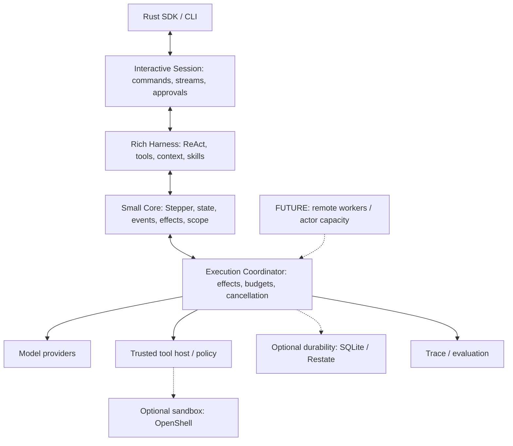

# Architecture

## Two views

Autra is described by two orthogonal views:

1. **Runtime view** — how one Run produces decisions and Effects. See
   [`execution-model.md`](execution-model.md).
2. **Product stack** — what a user installs and which layer owns which
   guarantee. See the spec §4.4 and [`ADR-0003`](adr/0003-default-local-host.md).

The two views share the same domain objects (Session, Turn, Run, Effect) but
answer different questions.

## Three collaborating systems

| System | Question | Owns | Does not own |
|---|---|---|---|
| Rich Harness | How does the Agent think and use capabilities? | Engine, Context, Capability, Subagent, Model | Effect authorization, Run commit |
| Interactive Session | How does a user interact over time? | Session, Turn, history, follow-up, streams, approval/resume | Agent Loop, Effect authorization |
| Small Agent Core | How does one Run advance? | RunState, accepted events, Stepper, transition proposal, EffectIntent, Scope | I/O, Session storage, Tokio tasks |
| Execution Runtime | How is work authorized, committed, dispatched and cancelled? | Coordinator, commit, budgets, concurrency/join, policy | Interpreting engine-specific decisions |
| Host | What guarantees does the environment provide? | Local, durable, hosted execution | Replacing Agent semantics |

The dependency direction is API → Harness/Session → Core; Runtime drives Core and Harness.
Core never depends on Runtime. Hosts and adapters are orthogonal. This is a logical
responsibility view, not a crate dependency graph.

## Layers



Bidirectional arrows mean logical collaboration, not a dependency cycle. Core
state transitions stay Sans-I/O; Effect execution belongs to the host.

## Dependency direction

```text
autra-core
  ↑
autra-harness
  ↑
autra-runtime
  ↑
autra-cli

optional adapters:
autra-openai · autra-durable-sqlite · autra-restate · autra-openshell
```

`autra-core` must not contain `OpenShellClient`, a SQLx pool, a Restate
context, a Kubernetes type or an HTTP route. This is enforced by Cargo: the
core has no Tokio, database or sandbox dependency.

## Current crates

| Crate | Role | Status |
|---|---|---|
| `autra-core` | IDs, AgentState, accepted events, Effect intents, budgets, cancellation, Stepper trait | MVP |
| `autra-harness` | ReAct Stepper, model boundary, tool contract, workspace read-only tools | MVP |
| `autra-runtime` | Local coordinator, Agent facade, events, budgets, cancellation, timeouts | MVP |
| `autra-cli` | `autractl run`, `demo`, `tools`, help | MVP |
| `autra-openai` | OpenAI-compatible chat completions provider | Implemented, non-streaming |
| `autra-eval` | Task-level outcome evaluation | Implemented |
| `autra-testkit` | Shared protocol contract checks | Implemented |
| `autra-durable-sqlite` | SQLite EffectRecord journal v0 | Implemented |

## Domain ownership vs code location

A concept can be core to the product without living in `autra-core`. The
`CORE` marker in the design spec means semantics the framework must guarantee,
not a required crate location.

| Concept | Domain owner | Current code |
|---|---|---|
| Session | Session layer | `autra-runtime` |
| Turn | Session layer | `autra-runtime` |
| Run | Core + runtime | `autra-core` state; `autra-runtime` execution |
| ChildRun | Core + runtime | tool-backed subagent; runtime ChildRun pending |
| Effect | Core + host | `EffectIntent` in Core, outcome in Core, dispatch in runtime |
| Context | Harness | `autra-harness` ContextBuilder |
| Workspace | Core reference + adapter | `LocalWorkspace` in harness; sandbox pending |

`AgentState` is the Run state. It carries optional `SessionId` and `TurnId`
references, so a Run can be correlated without Core owning Session lifecycle.

## Product stack and guarantees

| Layer | Promise |
|---|---|
| Developer API | Ergonomics only; no new execution semantics |
| Framework | State transition, concurrency, cancellation, approval and context semantics |
| Execution host | Authoritative journal, Effect acceptance, recovery boundary |
| Adapters | Isolation, credentials, limits; never execution authority |
| Compute (future) | Capacity and placement; never Core semantics |

The local host (`LocalEphemeral`) does not promise recovery after process
exit. That is a product-level guarantee, not an implementation detail.
