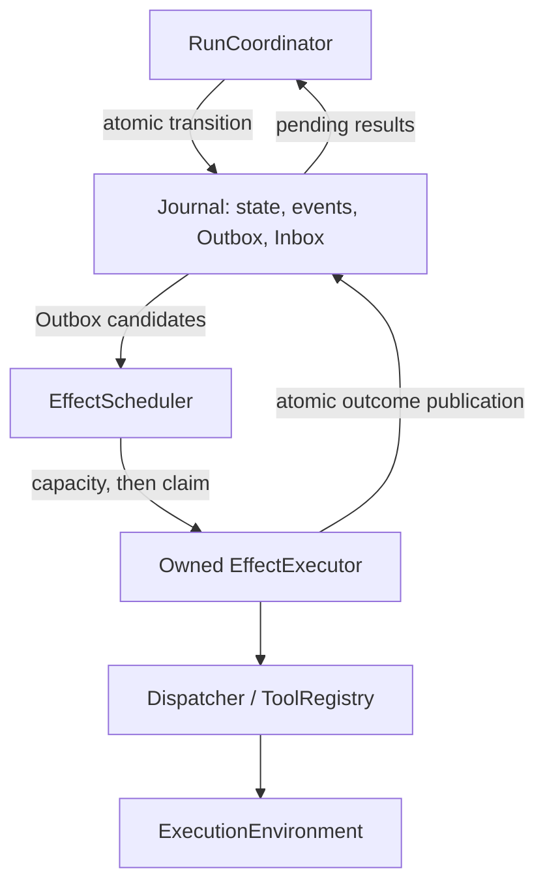

# Environment and durable Inbox runtime refactor

Baseline: `5a011a2d674cd8787bcdae860465e5df81291ed5` (`mvp-v1`).
Implemented on `refactor/runtime-environment-inbox`; see
[ADR-0061](adr/0061-environments-and-durable-result-inbox.md).

## Resulting boundaries

The Sans-I/O Core, AgentStepper, Harness behaviour, Dispatcher/ToolRegistry,
TransitionCommitter and Journal retain their responsibilities. RunCoordinator
owns authoritative RunState transitions. EffectExecutor owns execution
services without borrowing LocalEngine. Journal owns the consistency boundary.

| Area | Before | Implemented |
|---|---|---|
| Resources | File/process tools use LocalWorkspace directly | ExecutionEnvironment file/process contracts; Local and Sandbox adapters |
| Executor | Borrows LocalEngine | Owned ExecutionDependencies; independently runnable worker task |
| Result delivery | Pooled results depend on an in-memory channel | Journal Result Inbox; channel carries wake hints and lossy stream deltas |
| Scheduling | Global Model/Tool/Process limits | Environment affinity, capability checks and per-environment limits in addition to global limits |
| Recovery | Outbox claims and Run leases | Atomic result publication/consumption, immutable result deduplication, live-lease fencing and takeover tests |



Pure Model Effects call ModelProvider without requiring an Environment.

## ExecutionEnvironment

`autra-execution` defines ExecutionEnvironment, EnvironmentProvider, protocol
version, capability requirements, file metadata, bounded reads, atomic
compare-and-write, commands and typed errors. A provider acquires/releases
stable environment identities. Unsupported operations fail explicitly.

`autra-harness` provides LocalEnvironment and LocalEnvironmentProvider. Existing
LocalWorkspace tool constructors remain adapters. File confinement, atomic
writes, optimistic edit checks, process timeout/cancellation, process-tree
cleanup and bounded output are retained. Tools also accept an environment via
`in_environment`; execution uses the environment selected in ToolContext.

`autra-runtime` provides SandboxEnvironment and SandboxEnvironmentProvider over
SandboxBackend. Existing backends compile with unsupported file operations by
default; implementing the optional file methods advertises file capability.
Errors after command dispatch can be OutcomeUnknown. Shell commands in this
adapter currently require a POSIX-compatible sandbox shell.

ExecutionHost remains available for compatibility and observation. Its legacy
workspace snapshot capability is retained; resource capability discovery for
new dispatch paths belongs to ExecutionEnvironment.

## Owned execution and scheduling

`LocalEngine::effect_executor()` returns an owned executor. Its
`execute_pending` API requires no live Engine borrow. Dependencies explicitly
include Dispatcher, tools, Journal, scheduler, policy and approval services.

`AgentBuilder::scheduler(Arc<GlobalScheduler>)` shares one scheduler among
Agents. `register_environment(environment, concurrency)` sets a per-environment
quota; an optional EnvironmentProvider resolves identities lazily. Global
Model/Tool/Process quotas remain independent.

EffectRecord stores ExecutionRequirements. Required affinity must resolve the
exact identity; Preferred may select another compatible environment; Any
selects a compatible registered environment. Capabilities and protocol are
validated. The selected identity is pinned before external I/O. Built-in
workspace tools request their bound identity, so restoring a Run cannot
silently switch workspaces.

For built-in Inbox-capable Journals, dispatch first inspects due candidates,
reserves environment/global capacity, then claims the selected Effect. Waiting
for capacity does not hold an Effect lease. Permits survive actual execution
and are released even if a queued acquire future is dropped during handoff.

## Durable messaging protocol

Use `AgentBuilder::pooled_execution(true)` with MemoryJournal or SqliteJournal
to run the independent per-Run worker. Default execution remains inline. Memory
supports atomicity and concurrency within its process; SQLite survives process
restart. Pooled execution requires an Inbox-capable Journal and refuses a
legacy adapter that cannot provide the protocol.

1. TransitionCommitter atomically commits the accepted event, versioned state,
   newly recorded Effects and Authorized Outbox entries.
2. Executor reserves capacity, takes a live claim and persists Dispatched
   before invoking external I/O. Claim identity and generation fence writes.
3. Executor atomically writes Effect/Attempt outcome, inserts an EffectResult
   into Inbox and retires Outbox. Full ModelOutput includes tool calls,
   thinking and usage. No acceptance depends on stream/channel delivery.
4. Coordinator reads Inbox, asks Stepper for a transition, then atomically
   consumes the result identity and commits the next state/event/Effects.
   The same transaction checks expected state version and live Run ownership.

Result identity is `(effect_id, attempt_id)`. Exact duplicate publications are
acknowledged; conflicting publications and repeated consumption are rejected.
An exact duplicate acknowledgement does not grant a stale worker write access.
Consumed rows remain deduplication tombstones until Run garbage collection.
Explicit reconciliation retires superseded pending results and preserves
monotonic claim generations.

Run leases are acquired before loading recovery state. Expired leases cannot
renew or write, even before another owner takes over. Approval callbacks and
terminal commits are also fenced. Reclaiming an already Dispatched Effect
produces OutcomeUnknown instead of repeating an uncertain external action,
consistent with ADR-0039. Terminal Run garbage collection waits for outstanding
Outbox entries to retire.

Dropping a Coordinator is not cancellation: the owned worker finishes committed
Outbox work, and another Coordinator can consume its results. Cancellation
intent remains journaled and is polled during execution. Model failures are
stored as results and committed as terminal state by the Coordinator. Child
budget usage is merged without losing concurrent reservations.

## Compatibility and migration

- SQLite schema version 3 adds `result_inbox` and its indexes. Journal and
  Session Store share one atomic migration transaction, including the schema
  version update; opening either store initializes the database schema.
  Existing version 2 databases migrate automatically; unsupported older or
  newer versions retain their explicit error behaviour. Rollback to an older
  binary requires restoring a compatible database backup.
- New serialized EffectRecord fields have defaults. Each pooled Effect also
  persists its result-delivery mode. Resume detects this marker, so restarting
  an Agent without repeating the pooled flag still consumes durable results.
- Legacy resource-dependent Effects without an environment identity fail
  closed. Restore/migrate an explicit binding after verifying the workspace;
  do not infer it from whichever tools happen to be registered on restart.
- Existing custom Journal adapters retain the inline compatibility path.
  New atomic/owned methods fail closed by default. An adapter must implement
  the complete protocol before advertising `supports_result_inbox()`.
- Public struct literals for EffectRecord, ToolContext and DispatchOptions may
  need the added fields. Custom tools opt into environment requirements and
  use ToolContext.environment for routed execution.

## Validation

Validated with Rust 1.100.0:

```sh
cargo fmt --all -- --check
cargo clippy --workspace --all-targets --all-features -- -D warnings
cargo test --workspace --all-features
cargo test -p autra-harness --no-default-features
git diff --check
```

All 372 workspace tests and 57 Harness tests without default features pass.
Tests cover Memory/SQLite atomic rollback, duplicate/conflicting results,
competing workers and independent SQLite connections, expired leases and
stale owners, interrupted Effects, detached Coordinator recovery with full
model output, capacity-before-claim, environment routing/quotas, dropped
permit handoff, approval rejection, cancellation, schema migration and GC.

## Scope limits

Workers are independent local Tokio tasks, currently created per Run. This
change supplies a remote-environment contract and Sandbox adapter; it does not
implement a production remote worker transport, distributed resource quotas,
or a service that hosts large numbers of suspended Runs without per-Run tasks.
Approval waiting still follows the existing flow; ADR-0060 remains proposed.
External side effects are not exactly-once: unknown outcomes need explicit
reconciliation or an external idempotency protocol. Persistent Inbox data
must be retained until its Run can safely be collected.
